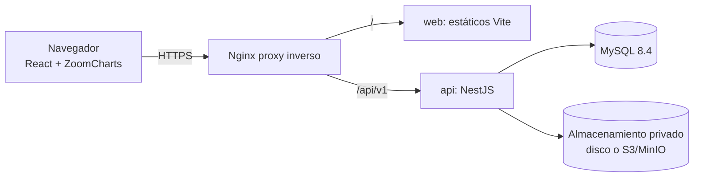

# Arquitectura

Documento vivo. Cada decisión indica si está verificada. La verificación de ZoomCharts está en
`01-verificacion-zoomcharts.md`.

## 1. Principios

1. **Privacidad por diseño:** todo recurso tiene propietario; la autorización se decide siempre en el
   servidor a partir de la sesión, nunca a partir de datos del cliente.
2. **ZoomCharts es solo presentación.** La fuente de verdad es MySQL. El estado de ZoomCharts
   (zoom, selección, layout) se separa de los datos del grafo.
3. **Los datos del grafo no salen del sistema** hacia terceros (proxy de exportación incluido).
4. **Nada se marca como guardado** hasta que el backend lo confirma.
5. **Verificar antes de afirmar:** lo no comprobado se marca como pendiente.

## 2. Vista general



Monorepo con npm workspaces:

```
apps/api            NestJS 12 (ESM) + Prisma 7
apps/web            React 19 + Vite + Tailwind 4 + shadcn/ui
packages/shared     Catálogo de tipos de entidad y esquemas Zod compartidos (sin dependencias de Node ni DOM)
docs/               Documentación
deploy/             Nginx, Dockerfiles, compose
```

`packages/shared` es la única fuente del catálogo de entidades (IDs estables, campos, reglas de
validación). El frontend lo usa para formularios y el backend para validar `metadata` JSON.

## 3. Pila y versiones fijadas

Versiones comprobadas en el registro npm el 2026-10-19. Se fijan con versión exacta y lockfile.

| Pieza | Versión | Justificación |
|---|---|---|
| MySQL | 8.4 LTS (instalado: 8.4.9); mínimo 8.0.16 | Imprescindible para que se apliquen los `CHECK` (antes se aceptaban y se ignoraban) y soporte JSON |
| Node.js | 24.x (instalado: 24.21.0) | Cumple `engines` de Vite 8 y NestJS 12 |
| TypeScript | **5.9.3** (modo estricto) | `latest` es 7.0.2, pero `@nestjs/swagger@12` declara `typescript ^5.5 \|\| ^6`; NestJS depende de metadatos de decoradores. Se evita 7.x |
| React | 19.3.1 | Estable |
| Vite | 8.3.4 | Estable (`latest`); requiere Node ≥20.19 |
| Tailwind CSS | 4.3.3 | Estable |
| React Router | 7.18.4 | Estable |
| TanStack Query | 5.104.5 | Estable |
| React Hook Form / Zod | 7.90.0 / 4.6.7 | Estables |
| ZoomCharts | `@dvsl/zoomcharts` 1.21.21 | Ver documento 01; sin wrapper |
| NestJS | 12.2.0 (**solo ESM**) | El backend se compila como ESM (`module: NodeNext`) |
| Prisma | **7.10.1** + `@prisma/adapter-mariadb` (adaptador oficial para MySQL/MariaDB) | `latest` es 8.0.0-rc.23 (release candidate): se descarta; 7.10.1 es la última estable (`prev`) |
| class-validator | 0.15.1 | Pedido por el enunciado |
| Argon2id | `argon2` 0.45.1 | Hash local de contraseñas |
| Rate limiting | `@nestjs/throttler` 6.7.1 | Compatible con Nest 7–12 |
| Cabeceras | `helmet` 8.3.0 | |
| PPTX | `pptxgenjs` 4.0.1 | ZoomCharts no exporta PPTX |
| PDF | `pdf-lib` 1.17.1 | Título, fecha, leyenda, márgenes |
| Tests | Vitest 5.0.5, `@playwright/test` 1.64.1, Supertest | |
| Almacenamiento S3 | `@aws-sdk/client-s3` | MinIO con `endpoint` + `forcePathStyle` |

Cualquier cambio de versión exige actualizar esta tabla. No hay betas, salvo que se justifique aquí.

## 4. Modelo de datos

Entidades obligatorias (`User`, `Folder`, `Graph`, `GraphNode`, `GraphEdge`, `ExportFile`,
`AuditLog`) más tablas auxiliares necesarias: `Session`, `PasswordResetToken`.
Esquema completo en `apps/api/prisma/schema.prisma`.

Decisiones:

- **Sin entidades reutilizables entre grafos en v1.** Cada `GraphNode` pertenece a un único grafo
  (`graphId`). Reutilizar nodos entre grafos exigiría una tabla `Entity` global y semántica de
  sincronización; se descarta para evitar duplicaciones inconsistentes. **Duplicar un grafo** copia
  nodos y aristas con nuevos UUID dentro de una transacción.
- **`graphDataVersion`** = versión del *formato* de los datos del grafo (migraciones de esquema JSON).
  **`revision`** = contador entero de concurrencia optimista (se incrementa en cada cambio). Son
  campos distintos para no mezclar conceptos.
- **Integridad entre grafos:** las aristas llevan `graphId`, `sourceNodeId`, `targetNodeId`. Una clave
  foránea compuesta `(graphId, sourceNodeId) → GraphNode(graphId, id)` impide en la propia base de
  datos conectar nodos de grafos distintos o de otro propietario. Se aplica con SQL en la migración
  (Prisma no modela este caso de forma limpia, ver `schema.prisma`).
- **Borrado:** `User → Folder/Graph/Export`: `Cascade` (retención: ver §8). `Folder → Graph`:
  `Restrict` en base de datos; la API implementa la política explícita elegida por el usuario
  (mover contenido a la carpeta padre o eliminar con confirmación). `Graph → Node/Edge/Export`:
  `Cascade`. `Node → Edge`: `Cascade`. Los grafos tienen borrado lógico (`deletedAt`, papelera) con
  purga programable; carpetas y nodos se borran físicamente.
- **Particularidades de MySQL (todas verificadas contra un MySQL 8.4.9 real):**
  - `@db.Uuid` y `timestamptz` no existen: los IDs son `CHAR(36)` y las fechas `DATETIME(3)` en UTC.
  - No hay arrays nativos: `tags` es una columna JSON (un `CHECK` impone que sea array) y la API
    siempre envía `[]`/`{}` porque Prisma no admite valores por defecto JSON en MySQL.
  - La collation por defecto (`utf8mb4_unicode_ci`) **no distingue mayúsculas**: el correo es único sin
    importar mayúsculas, y el `CHECK` de minúsculas usa `COLLATE utf8mb4_bin` (sin eso nunca fallaría).
  - MySQL prohíbe `CHECK` sobre columnas con `ON UPDATE CASCADE` (error 3823). Las relaciones de
    `Folder.parent` y de origen/destino de `GraphEdge` usan `onUpdate: NoAction` (los UUID no cambian).
  - La FK compuesta de aristas funciona igual: una arista que cruza de un grafo a otro es rechazada por
    la base de datos aunque los nodos existan.
  - Autenticación `caching_sha2_password` (por defecto en 8.4): el conector necesita TLS o clave pública.
    En `localhost` se permite `allowPublicKeyRetrieval`; en hosts remotos se exige `?ssl=true`.- **JSON validado:** `metadata` se valida con el esquema Zod del tipo de entidad (de
  `packages/shared`) antes de persistir; `positionX/Y` son `Float?`.
- **Archivos:** sólo metadatos en MySQL (`storageKey`, `fileSize`, `format`, `sha256`). Nunca
  binarios ni base64.
- **Índices:** `(ownerId, updatedAt)`, `(ownerId, folderId)`, `(graphId)`, `(graphId, type)`,
  `(graphId, sourceNodeId)`, `(graphId, targetNodeId)`, trigram opcional sobre `label` para
  búsqueda (`LIKE` con prefijo o índice `FULLTEXT`, a decidir en Fase 3 según medición).

## 5. Autenticación y sesiones

- **Sesiones en servidor** con identificador opaco de 256 bits (aleatorio, `crypto.randomBytes`);
  en base de datos sólo se guarda `HMAC-SHA256(SESSION_SECRET, token)` (si se filtra la tabla, los
  hashes no sirven sin el secreto del servidor). Cookie `HttpOnly`, `Secure` en producción,
  `SameSite=Lax`, `Path=/`, caducidad deslizante con tope absoluto. Revocables (`revokedAt`) y
  listables desde el perfil.
- **Contraseñas:** Argon2id (`argon2`), parámetros configurables por entorno, política mínima de
  longitud y comparación de tiempo constante. Cambio de contraseña revoca el resto de sesiones.
- **Recuperación:** token aleatorio de un solo uso, hash en BD, caducidad corta (30 min), se
  invalida al usarlo. Respuesta idéntica exista o no la cuenta (anti-enumeración). En desarrollo el
  "correo" se escribe en consola / fichero (la entrega SMTP queda como adaptador a configurar).
- **Fuerza bruta/abuso:** `@nestjs/throttler` por IP y por clave de cuenta en login, registro y
  recuperación; retardo uniforme; mensajes de error genéricos.
- **CSRF:** cookie `SameSite=Lax` + verificación de cabecera `Origin`/`Referer` contra una lista
  permitida en todas las peticiones no seguras + exigencia de `Content-Type: application/json` o
  cabecera personalizada `X-Requested-With`. CORS restrictivo (sin comodines con credenciales).
- **Validación de sesión en servidor** en cada petición mediante `AuthGuard` global (deny by default,
  rutas públicas con decorador `@Public()` explícito).

## 6. Autorización y aislamiento (IDOR)

- `ownerId` jamás se acepta del cliente: se obtiene de la sesión (`@CurrentUser()`).
- **Toda** consulta de recursos pasa por una capa de acceso que añade el filtro del propietario, p. ej.
  `findGraphOwned(userId, graphId)`; nodos, aristas y exportaciones se resuelven *a través del grafo
  propio* (`where: { id, graph: { ownerId } }`). Existe una regla de revisión/lint: no se usa
  `prisma.<modelo>.findUnique({ where: { id } })` sin filtro de propietario en módulos de dominio.
- Recursos ajenos o inexistentes devuelven **404** idéntico (no 403) para no revelar existencia.
- UUID validados con `ParseUUIDPipe` (v4) y DTO estrictos con `whitelist` + `forbidNonWhitelisted`.
- Pruebas obligatorias (Fase 8, empezando en Fase 2): usuario A frente a recursos de B para
  leer, editar, exportar, eliminar y descargar, conociendo los UUID.

## 7. API REST (`/api/v1`)

```
POST   /auth/register | /auth/login | /auth/logout | /auth/forgot-password | /auth/reset-password
GET    /auth/sessions            DELETE /auth/sessions/:id
GET/PATCH /users/me              POST /users/me/password
GET/POST/PATCH/DELETE /folders[/:id]
GET/POST/PATCH/DELETE /graphs[/:id]       POST /graphs/:id/duplicate | /graphs/:id/restore
GET    /graphs/:id/content                (entidades, relaciones y revisión)
PUT    /graphs/:id/content                (instantánea completa + expectedRevision; 409 REVISION_CONFLICT con details.currentRevision)
       [Fase 5: sustituye a nodes/edges/changes; ver docs/03-plan-implementacion.md]
POST   /graphs/:graphId/exports           (Fase 7: cuerpo binario crudo; nombre en X-Export-Name; ?folderId=<uuid|root>)
GET    /graphs/:graphId/exports           (exportaciones de un grafo)
GET    /files                             (todas las del usuario: search, format, graphId, page, pageSize)
GET/PATCH/DELETE /files/:id               GET /files/:id/content   (descarga autenticada)
GET/PATCH/DELETE /files/:id               GET /files/:id/content  (descarga autorizada)
GET    /search?q=                         (limitada al propietario)
GET    /health
```

Errores con formato uniforme `{ statusCode, error, message, requestId }`, sin trazas ni datos internos.
OpenAPI en `/api/docs` sólo con `NODE_ENV !== production`. Paginación por `page/pageSize` con tope.

## 8. Guardado y concurrencia

- Cada `Graph` tiene `revision`. Las escrituras (`changes`, y las operaciones sueltas de nodo/arista)
  reciben `expectedRevision`; en la transacción se hace
  `UPDATE graph SET revision = revision + 1 WHERE id = ? AND owner_id = ? AND revision = ?`.
  Si no afecta a ninguna fila → **409** con la revisión actual. El cliente muestra el conflicto y
  ofrece recargar o conservar la copia local; no sobrescribe en silencio.
- Estados de UI: `Guardando`, `Guardado`, `Error al guardar` y `Cambios sin guardar`. "Guardado" sólo
  tras respuesta 2xx del servidor.
- Autoguardado con *debounce*, cola local de operaciones pendientes, reintento con *backoff* ante
  fallo de red, y `beforeunload` si hay pendientes.
- Posiciones y ajustes de presentación (zoom, vista) se guardan junto al grafo en un campo
  `viewState` JSON pequeño (no son la fuente de verdad del contenido).

## 9. Editor y ZoomCharts

- `NetChartCanvas`: componente propio. Crea la instancia una vez (protegido contra doble montaje de
  `StrictMode`), recibe `data` como modelo normalizado y aplica diferencias con
  `addData/replaceData/removeData/updateStyle` en lugar de recrear el gráfico. Cleanup con `remove()`.
- Capa `graphToZoomCharts()` pura y testeable que transforma el modelo del dominio en nodos/enlaces
  de ZoomCharts usando el catálogo de `packages/shared`. Sin lógica de negocio en el componente.
- Estado: TanStack Query para datos del servidor; un *store* local (reducer) para ediciones
  pendientes y estado de guardado; estado de presentación de ZoomCharts separado (ref).
- Formas, leyenda y exportación: ver documento 01 (spikes en Fase 4 y 6).
- **Vista de exploración (Fase 6b)**: `computeView(doc, view, pinned)` (puro, en `view-filter.ts`) deriva del documento
  completo el subconjunto visible (tipos, naturaleza, fechas, enfoque con vecinos expandidos); la selección va
  siempre fijada. Solo el lienzo recibe el documento derivado: guardado, historial y paneles trabajan con el completo.
  `NetChartCanvas` recuerda las posiciones de los nodos que se ocultan para devolverlos donde estaban. Los halos usan
  `auras` de ZoomCharts: no se pasa la clave `auras` en la configuración inicial si no hay halos (provoca un desajuste
  entre dibujo y detección del ratón) y los cambios van con `updateSettings`.

## 10. Exportaciones

- Generación **en el cliente** (la imagen sólo existe en el canvas del navegador): PNG/JPEG con
  `exportAsString`; PDF con `pdf-lib` (título, fecha, leyenda, márgenes, ajuste); PPTX con
  PptxGenJS (modo imagen y modo editable). Las instantáneas se obtienen de la API autorizada.
- "Guardar exportación en la aplicación": el cliente sube el fichero a
  `POST /graphs/:graphId/exports`; el backend verifica propiedad, tamaño máximo, tipo MIME declarado
  contra la **firma binaria real** (PNG, JPEG, `%PDF`, ZIP/OOXML para PPTX), calcula SHA-256, guarda
  en el almacenamiento privado y registra metadatos.
- Descarga: `GET /files/:id/content` tras verificar propietario; `Content-Disposition: attachment`,
  `X-Content-Type-Options: nosniff`, `Cache-Control: private, no-store`. Sin URLs públicas. Si en el
  futuro se usan enlaces temporales: token firmado de corta duración emitido tras validar permisos.
- Límites configurables: tamaño de archivo, nº de nodos/aristas por grafo, píxeles máximos, *timeout*.
- **Implementado (Fase 7):** la subida usa cuerpo binario crudo (`express.raw`, solo para ese `POST` y solo con cookie
  de sesión) en lugar de `multipart`; el nombre viaja codificado en `X-Export-Name` y nunca en la URL. El `Content-Type`
  declarado debe coincidir con el formato detectado por firma (si no, 415). El nombre se guarda sin extensión y la
  descarga usa la extensión real del contenido. Cuotas: `MAX_EXPORTS_PER_USER` (500), `EXPORT_QUOTA_MB_PER_USER` y
  `MAX_EXPORT_FILE_MB` (413/409). Orden: comprobación previa → `storage.put` → bloqueo por propietario (se vuelve a
  comprobar grafo en papelera, carpeta propia y cuota) → fila; si falla, se borra el objeto. Todo es opcional: el
  cliente solo sube si el usuario marca «Guardar una copia en mi cuenta».

## 11. Almacenamiento privado

Interfaz `StorageService { put, get(stream), delete, exists }` con dos adaptadores:

- `LocalDiskStorage`: directorio fuera de cualquier ruta servida (`STORAGE_LOCAL_DIR`), claves
  `exports/<ownerId>/<uuid>` generadas por el servidor (el nombre del usuario nunca forma parte de la
  ruta), comprobación anti *path traversal*.
- `S3Storage`: `@aws-sdk/client-s3`, compatible con MinIO (`S3_ENDPOINT`, `forcePathStyle`).

**Estado (Fase 7):** ambos adaptadores implementados con un contrato común probado en `test/storage.test.ts`.
`LocalDiskStorage` escribe de forma atómica (temporal + `rename`, modo 0600). `S3Storage` solo se ha verificado contra un
servidor S3 simulado en memoria: **no se ha probado con MinIO ni S3 reales**. Sin cifrado en reposo ni reconciliación de
objetos huérfanos (ver `03-plan-implementacion.md`, Fase 7). `StorageService` lo provee `CoreModule` según
`STORAGE_DRIVER`.

## 12. Seguridad transversal

`helmet` + CSP restrictiva (verificada en Fase 8 con el SDK real: `script-src 'self'`, `connect-src` solo `'self'` y `api.zoomcharts-cloud.com`; Zod se configura con `jitless` para no necesitar `unsafe-eval`), `Strict-Transport-Security` en producción, límites de tamaño de cuerpo, `ValidationPipe`
global, filtro de excepciones que oculta detalles internos, logs estructurados con redacción de
campos sensibles (contraseñas, tokens, cookies, `metadata`, contenido de grafos), `AuditLog` con
metadatos mínimos (sin contenido). Retención: borrado definitivo de grafos en papelera tras N días
(configurable), purga de sesiones y tokens caducados, y supresión de cuenta con borrado en cascada
de sus recursos y ficheros.

Los campos sensibles del catálogo (p. ej. identificador interno, catastral, VIN, matrícula) se
marcan con `sensitive: true`: se enmascaran en listados y en búsqueda global, sólo se muestran en el
detalle del propietario y nunca se escriben en logs. El cifrado a nivel de campo en reposo se
valorará en Fase 8 (ver limitaciones).

## 13. Pruebas

| Nivel | Herramienta | Alcance |
|---|---|---|
| Unitarias | Vitest | catálogo/validación, transformación a ZoomCharts, servicios |
| Integración API | Vitest + Supertest + MySQL real (BD de pruebas aislada) | auth, aislamiento A/B, concurrencia, exportaciones |
| E2E | Playwright | los 18 criterios de aceptación aplicables al navegador |
| Seguridad (API) | Vitest + Supertest | `security.e2e.test.ts`: inventario real de rutas con «denegar por defecto», matriz A/B sobre todas las rutas con id, CSRF en toda ruta no segura, cabeceras en 401/404/400/403, fuzzing sin 5xx, logs sin secretos |
| Seguridad (borde) | Playwright contra Docker | `apps/web/e2e-stack`: cabeceras/CSP, cuerpos, `limit_req`, solo Nginx publicado, aplicación bajo la CSP |
| Multinavegador | Playwright | proyectos `edge`, `firefox` y `webkit` sobre la misma batería (`npm run e2e:cross` para los dos últimos) |
| Repositorio | Vitest + script | `scripts/secret-scan.mjs` (ficheros versionables e imágenes) con sus propias pruebas |

Las pruebas de integración requieren MySQL (`TEST_DATABASE_URL`; se omiten si no está definida). No se simula la base de
datos con una distinta para no ocultar diferencias de comportamiento.

## 14. Despliegue

Detalle completo en `10-despliegue.md`. Resumen: `docker-compose.yml` con `db` (MySQL 8.4), `migrate` (trabajo de un solo uso:
`prisma migrate deploy`), `api` (NestJS, sin privilegios, sistema de ficheros de solo lectura) y **un único contenedor `web`**
(Nginx sin privilegios que sirve los estáticos, hace de proxy de `/api/` y termina TLS en el puerto 8443, el único publicado).
`db` y `api` viven en una red interna sin salida a Internet. Los secretos solo entran por variables de entorno
(`.env.docker`, no versionado; plantilla en `.env.docker.example`); la licencia de ZoomCharts se inyecta al arrancar `web`
en un `config.js` en `tmpfs`, nunca en el bundle ni en la imagen.

> **Estado de verificación (criterio 16):** verificado con Docker Desktop en Windows desde volúmenes nuevos: migraciones,
> servicios sanos, solo Nginx publicado, cabeceras/CSP/HSTS/cookies/CSRF/límites en el borde, la aplicación completa
> (lienzo real y exportaciones) sin violaciones de CSP, persistencia tras reinicio y seed. Sin verificar: servidor Linux real,
> certificado de una CA, S3/MinIO reales y SMTP (ver `10-despliegue.md`, «Límites»).